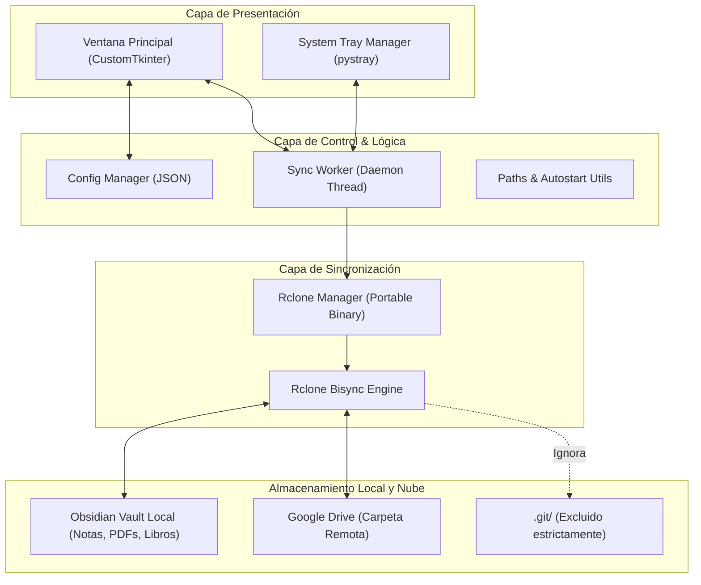

# Especificación Técnica: Obsidian GDrive Sync

**Fecha:** 2026-09-20  
**Estado:** Propuesta de Diseño  
**Plataformas:** Windows (10/11) y Linux (Ubuntu/Debian, Fedora, Arch, etc.)  

---

## 1. Resumen Ejecutivo

**Obsidian GDrive Sync** es una aplicación de escritorio ligera, moderna y multiplataforma diseñada para sincronizar de forma bidireccional (2-way) un vault de Obsidian (compuesto por notas Markdown, imágenes, recursos adjuntos y libros en formatos PDF/EPUB) con Google Drive personal.

La aplicación opera bajo el paradigma de **configuración simple y persistencia en segundo plano**:
1. Una interfaz gráfica limpia (GUI) permite configurar la carpeta local del vault, la carpeta remota en Google Drive, el intervalo de sincronización (por defecto **2 minutos**) y conectar la cuenta de Google con un solo clic en el navegador.
2. Al pulsar *"Iniciar Sincronización"*, la aplicación minimiza su presencia al **área de notificación / bandeja del sistema (System Tray)**, permitiendo cerrar la ventana principal sin interrumpir el daemon de sincronización continua.
3. Coexiste de forma transparente con **Obsidian Git** (GitHub), excluyendo estrictamente los metadatos internos de Git para evitar bloqueos y conflictos.

---

## 2. Arquitectura del Sistema

El sistema sigue un diseño modular desacoplado, separando la capa de presentación (GUI y System Tray), la capa de orquestación (Worker e Hilos) y el motor de sincronización de bajo nivel.



### 2.1 Estructura del Código Fuente

```text
obsidian-gdrive-sync/
├── docs/
│   └── superpowers/
│       └── specs/
│           └── 2026-09-20-obsidian-gdrive-sync-design.md
├── src/
│   ├── __init__.py
│   ├── main.py                  # Inicializador, single-instance check y arranque
│   ├── gui/
│   │   ├── __init__.py
│   │   ├── app_window.py        # Ventana principal en CustomTkinter
│   │   └── components.py        # Componentes UI (selectores, inputs, badge de estado, tabla logs)
│   ├── tray/
│   │   ├── __init__.py
│   │   ├── tray_icon.py         # Manejo del System Tray (pystray) e intercepción de cierre
│   │   └── assets/              # Iconos en formatos PNG e ICO (verde, azul, amarillo, rojo)
│   ├── core/
│   │   ├── __init__.py
│   │   ├── config.py            # Persistencia de settings en %APPDATA% / ~/.config
│   │   ├── rclone_manager.py    # Detección/descarga del binario y flujo OAuth2 de Google Drive
│   │   ├── sync_worker.py       # Loop de sincronización periódica en hilo secundario
│   │   └── filter_rules.py      # Definición de reglas de exclusión (Git, Obsidian cache)
│   └── utils/
│       ├── __init__.py
│       ├── paths.py             # Resolución de rutas nativas por SO
│       ├── logger.py            # Sistema de logs rotativos
│       └── autostart.py         # Registro de inicio automático en Windows y Linux
├── tests/
│   ├── __init__.py
│   ├── test_config.py           # Pruebas unitarias de lectura/escritura de configuración
│   ├── test_filter_rules.py     # Pruebas de reglas de exclusión y comandos
│   └── test_sync_worker.py      # Pruebas de máquina de estados del worker
├── requirements.txt             # Dependencias del proyecto
└── README.md                    # Guía de uso y configuración rápida
```

---

## 3. Especificación de Componentes

### 3.1 Gestor de Configuración (`src/core/config.py`)
- **Ubicación del archivo:**
  - **Linux:** `~/.config/obsidian-gdrive-sync/config.json`
  - **Windows:** `%APPDATA%\ObsidianGDriveSync\config.json`
- **Esquema JSON:**
  ```json
  {
    "local_vault_path": "/home/user/Obsidian/MiVault",
    "remote_folder_name": "ObsidianVault",
    "sync_interval_minutes": 2,
    "autostart_enabled": false,
    "first_sync_done": false,
    "last_sync_timestamp": "2026-09-20T16:40:00Z",
    "last_sync_status": "success",
    "theme": "dark"
  }
  ```
- **Responsabilidad:** Carga inicial, validación de tipos, escritura atómica y emisión de eventos de cambio de configuración.

### 3.2 Gestor de Rclone y Autenticación (`src/core/rclone_manager.py`)
- **Gestión del ejecutable:**
  1. Comprueba si existe `rclone` en el `$PATH` del sistema.
  2. Si no existe, descarga la versión oficial compilada para la plataforma correspondiente (x86_64 / arm64 en Linux; x64 en Windows) y la almacena en un directorio de datos local de la aplicación (`bin/rclone` o `bin/rclone.exe`).
- **Autenticación con Google Drive:**
  - Invoca el comando interactivo de autorización:  
    `rclone authorize "drive" "scope drive"` (o `rclone config create gdrive drive scope=drive`).
  - Rclone inicia un servidor local temporal en `http://127.0.0.1:53682/` y abre el navegador predeterminado del usuario.
  - El usuario aprueba el acceso en su cuenta de Google.
  - Rclone captura el token OAuth2 (access token y refresh token) y lo guarda en su archivo de configuración interno (`rclone.conf`).
  - Google Drive gestiona automáticamente el refresco silencioso del token sin intervención del usuario.

### 3.3 Motor y Filtros de Sincronización (`src/core/filter_rules.py` y `sync_worker.py`)
- **Reglas de exclusión estrictas (Obsidian + Git):**
  Para garantizar la integridad y evitar bucles continuos:
  - `- .git/**` *(Asegura compatibilidad 100% con Obsidian Git/GitHub)*
  - `- .gitignore`
  - `- .obsidian/workspace.json` *(Layout dinámico que cambia en cada clic)*
  - `- .obsidian/workspace-mobile.json`
  - `- .obsidian/cache/**`
  - `- *.tmp`
  - `+ *` *(Incluye todo lo demás: .md, .png, .jpg, .pdf, .epub, .obsidian/plugins/**, .obsidian/themes/**)*
- **Comando de Sincronización:**
  - Primera ejecución (inicialización de línea base):
    ```bash
    rclone bisync "/ruta/vault" "gdrive:ObsidianVault" \
      --resync \
      --filters-file "filtros.txt" \
      --drive-chunk-size 32M \
      --conflict-resolve none \
      --conflict-loser pathname \
      --verbose
    ```
  - Sincronizaciones continuas periódicas:
    ```bash
    rclone bisync "/ruta/vault" "gdrive:ObsidianVault" \
      --filters-file "filtros.txt" \
      --drive-chunk-size 32M \
      --conflict-resolve none \
      --conflict-loser pathname \
      --check-access \
      --retries 3 \
      --verbose
    ```
- **Resolución de Conflictos:**
  - Al usar `--conflict-resolve none` y `--conflict-loser pathname`, si una nota o archivo es modificado simultáneamente en local y en la nube antes de sincronizar, Rclone mantiene la copia local intacta y descarga la versión remota con sufijo de conflicto (ej. `documento.conflict-2026-09-20.pdf`). Ningún dato se sobrescribe.
- **Prevención de Tareas Superpuestas:**
  - El `sync_worker` utiliza un bloqueo interno (`threading.Lock`). Si la subida de un libro o PDF de 500 MB tarda 4 minutos, el worker no iniciará otra sincronización a los 2 minutos; completará la transferencia en curso y reprogramará el siguiente ciclo 2 minutos después de la finalización exitosa.

### 3.4 Interfaz de Usuario (`src/gui/app_window.py`)
- Desarrollada con **CustomTkinter** para proporcionar controles estilizados, escalado HiDPI nativo y apariencia moderna en Windows y Linux.
- **Secciones de la ventana:**
  1. **Header de Estado:**
     - Etiqueta dinámica: `● Sincronizado hace 2 min` (verde) | `● Sincronizando...` (azul) | `● En pausa` (amarillo) | `● Error de red` (rojo).
  2. **Panel de Conexión:**
     - Estado de cuenta: `✓ Conectado a Google Drive (mi_cuenta@gmail.com)`
     - Botón: *"Conectar / Cambiar Cuenta"*
  3. **Panel de Configuración:**
     - Campo de texto y botón *"Examinar..."* para el vault local de Obsidian.
     - Campo de texto para la carpeta remota de Drive (default: `ObsidianVault`).
     - Selector de intervalo en minutos (campo numérico, mínimo 1, **default 2**).
     - Casilla de verificación: *"Iniciar automáticamente con el sistema"*.
  4. **Controles Principales:**
     - Botón principal de acción: *"Iniciar Sincronización"* / *"Pausar Sincronización"*.
     - Botón secundario: *"Sincronizar Ahora"* (fuerza ejecución inmediata).
  5. **Panel de Registro (Logs en vivo):**
     - Cuadro de texto scrollable con fecha, hora y lista de archivos modificados/transferidos en cada pasada.
- **Comportamiento al cerrar (Event `WM_DELETE_WINDOW`):**
  - Intercepta el evento de cierre de la ventana: no finaliza el proceso (`sys.exit()`), sino que ejecuta `app.withdraw()` (oculta la ventana) y muestra una notificación en el System Tray: *"Obsidian Sync continúa ejecutándose en segundo plano junto al reloj"*.

### 3.5 Integración con la Bandeja del Sistema (`src/tray/tray_icon.py`)
- Implementado con **pystray** y **Pillow**.
- **Icono dinámico en el área de notificación:**
  - 🟢 **Verde**: Daemon activo, sincronización al día.
  - 🔵 **Azul**: Sincronización en curso.
  - 🟡 **Amarillo**: Sincronización pausada.
  - 🔴 **Rojo**: Error de autenticación o fallo de red prolongado.
- **Menú contextual (Clic derecho):**
  - `Mostrar Ventana Principal` (vuelve a mostrar la interfaz con `app.deiconify()`).
  - `Sincronizar Ahora` (dispara `worker.trigger_immediate()`).
  - `Pausar / Reanudar Sincronización` (alterna el estado del worker).
  - `---` (Separador)
  - `Última sinc: 16:45` (Elemento deshabilitado informativo).
  - `---` (Separador)
  - `Salir` (detiene el worker de forma limpia y cierra el proceso).

---

## 4. Coexistencia con Git y Casos Límite

### 4.1 Coexistencia con Obsidian Git
- La exclusión de `.git/**` en el archivo de filtros garantiza que Rclone nunca inspeccione, bloquee ni transfiera el directorio de Git ni los archivos temporales como `.git/index.lock`.
- Flujo cruzado:
  - Cambios generados por Obsidian Git al hacer `git pull` son detectados por nuestro daemon como archivos ordinarios y subidos a Google Drive.
  - Cambios descargados desde Google Drive son vistos por Obsidian Git como modificaciones locales listas para `git commit` y `git push`.

### 4.2 Tolerancia a Fallos y Modo Offline
- **Pérdida de conectividad:** Rclone retorna código de error de red. El worker captura la excepción, actualiza el estado a `● Desconectado / Reintentando` sin emitir alertas intrusivas y espera al siguiente intervalo programado.
- **Archivos en uso / bloqueados:** Si el usuario está escribiendo activamente una nota en el momento del sync, Rclone no corrompe el archivo; si no puede leerlo de inmediato, lo omite temporalmente y lo procesa en el siguiente ciclo (2 minutos después).
- **Archivos grandes (Libros de 100MB+ / PDFs):** Se utiliza `--drive-chunk-size 32M`, permitiendo subidas fragmentadas y reanudables en caso de interrupciones de ancho de banda.

---

## 5. Plan de Pruebas y Verificación

### 5.1 Pruebas Automatizadas (Unit Tests)
- `test_config.py`:
  - Creación de configuración por defecto.
  - Carga y guardado atómico de valores en disco.
  - Validación de rutas inexistentes.
- `test_filter_rules.py`:
  - Generación del archivo de filtros.
  - Verificación de que `.git/**`, `.obsidian/workspace.json` y temporales están presentes en las reglas de exclusión.
- `test_sync_worker.py`:
  - Verificación del bucle del temporizador (intervalo de 2 minutos).
  - Comprobación de que llamadas repetidas a `sync` respetan el `Lock` (sin ejecuciones solapadas).
  - Manejo de transición de estados (`IDLE` → `SYNCING` → `SUCCESS` / `ERROR`).

### 5.2 Verificación Manual
1. **Flujo de Autenticación:** Abrir la app por primera vez, hacer clic en *"Conectar con Google Drive"*, verificar apertura de navegador y confirmación en la UI.
2. **Sincronización Bidireccional:**
   - Crear una nota `prueba_local.md` en Obsidian y esperar 2 minutos → verificar que aparece en Google Drive.
   - Crear un archivo `prueba_nube.txt` en Google Drive → esperar el ciclo y verificar que aparece en la carpeta local de Obsidian.
3. **Validación de Libros Pesados:** Colocar un archivo PDF de >100 MB en el vault local y confirmar sincronización completa sin cortes.
4. **Validación de Git:** Realizar un `git commit` en el vault local y verificar que `.git/` no se sube a Google Drive y que no hay bloqueos de `index.lock`.
5. **Validación del System Tray:** Cerrar la ventana principal con la `X`, comprobar que el icono sigue en la barra de tareas/reloj, y que la sincronización sigue corriendo periódicamente.
