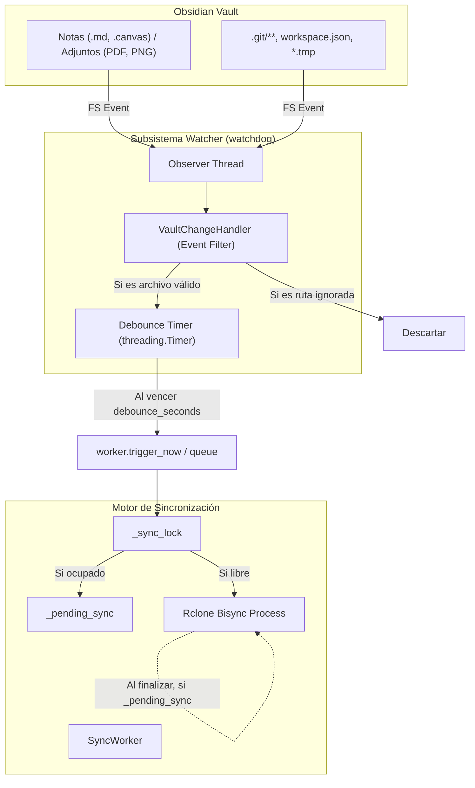

# Especificación Técnica: Sincronización en Tiempo Real (File Watcher con Debounce)

**Fecha:** 2026-09-26  
**Estado:** Propuesta Aprobada  
**Plataformas:** Windows (10/11) y Linux  

---

## 1. Resumen Ejecutivo

Esta especificación detalla el diseño técnico para transformar el motor de sincronización de **Obsidian GDrive Sync** de un modelo de sondeo pasivo (*polling* cada 2 minutos) a un **modelo reactivo e híbrido en tiempo real**:
1. **Detección Instantánea de Cambios Locales:** Monitoreo continuo a nivel del kernel del sistema operativo sobre el vault de Obsidian mediante la biblioteca `watchdog` (*inotify* en Linux, *ReadDirectoryChangesW* en Windows).
2. **Filtrado Riguroso:** Descarta de forma inmediata eventos sobre `.git/**`, `.obsidian/workspace*.json`, `.obsidian/cache/**` y archivos temporales para evitar bucles de sincronización y permitir total compatibilidad con Obsidian Git.
3. **Debounce Configurable:** Aplica una ventana de inactividad de escritura elástica (por defecto 5 segundos, ajustable por el usuario) tras la última pulsación o guardado antes de disparar la sincronización.
4. **Encolamiento Concurrente (`_pending_sync`):** Si el usuario guarda una nota mientras una sincronización de Rclone ya está en ejecución, los cambios no se descartan; se encolan automáticamente para ejecutarse de inmediato en cuanto la sincronización actual concluya.
5. **Estrategia Híbrida:** Conserva una comprobación periódica en segundo plano para descargar cambios remotos realizados desde dispositivos móviles u otros equipos.

---

## 2. Objetivos y No-Objetivos

### Objetivos
- Reducir la latencia de sincronización de minutos a pocos segundos tras editar notas, imágenes o adjuntos.
- Eliminar peticiones rclone redundantes e innecesarias cuando no hay actividad de escritura local.
- Permitir activar/desactivar la sincronización en tiempo real y personalizar los segundos de debounce desde la interfaz gráfica.
- Garantizar que nunca coexistan dos procesos `rclone bisync` simultáneos sobre la misma carpeta (prevención estricta de colisiones).
- Mantener la suite de pruebas unitarias al 100% con pruebas rápidas e independientes del entorno de producción.

### No-Objetivos
- No se desarrollará un plugin nativo de Obsidian en JavaScript/TypeScript (la aplicación observa la carpeta del sistema de archivos de forma no invasiva).
- El watcher local no detecta cambios remotos en Google Drive (para ello se conserva el ciclo de polling periódico).

---

## 3. Arquitectura y Componentes



### 3.1 Nuevo Módulo `src/core/vault_watcher.py`

* **`class VaultChangeHandler(FileSystemEventHandler)`**:
  - `__init__(self, callback: Callable[[], None], debounce_seconds: float = 5.0, ignored_patterns: list[str] | None = None)`
  - Mantiene un temporizador elástico `self._timer: threading.Timer | None`.
  - Método `should_ignore(path: str) -> bool`:
    - Normaliza la ruta relativa respecto a la raíz del vault.
    - Evalúa si coincide con:
      - `.git`, `.git/**`, `.gitignore`, `.git-credentials`
      - `.obsidian/workspace.json`, `.obsidian/workspace-mobile.json`
      - `.obsidian/cache`, `.obsidian/cache/**`
      - `.obsidian/plugins/obsidian-git/data.json`
      - `*.tmp`, `*~`, `*.swp`
  - Métodos `on_created`, `on_modified`, `on_deleted`, `on_moved`:
    - Si la ruta o la ruta destino (`dest_path`) son ignoradas, retorna inmediatamente.
    - Si es válida, llama a `_schedule_trigger()`.
  - `_schedule_trigger()`:
    - Cancela `self._timer` si está activo.
    - Inicia un nuevo `threading.Timer(self.debounce_seconds, self._on_timer_expired)`.
  - `stop()`: Cancela cualquier temporizador pendiente.

* **`class VaultWatcher`**:
  - Encapsula la instancia de `watchdog.observers.Observer`.
  - `start(path: str)`: Configura el observer en modo recursivo y lo inicia.
  - `stop()`: Detiene el observer y espera con timeout (`join(timeout=2)`).

### 3.2 Extensión de `src/core/sync_worker.py`

* **Variables de Estado en `SyncWorker`**:
  - `self.watcher: VaultWatcher | None = None`
  - `self._pending_sync: bool = False`
* **Callback de Activación del Watcher**:
  - `_on_watcher_event()`:
    - Si `self._paused` o no `self._running`: no hace nada.
    - Si `self._is_syncing` o `self._sync_lock.locked()`:
      - Activa `self._pending_sync = True`.
    - Si está libre:
      - Activa `self._wakeup_event.set()`.
* **Manejo de Encolamiento en `_execute_sync()`**:
  - En el bloque `finally`:
    - Si `self._pending_sync` es `True`:
      - Restablece `self._pending_sync = False`.
      - Activa `self._wakeup_event.set()` para que el siguiente ciclo inicie de inmediato.
* **Ciclo de Vida Integrado**:
  - `start()`: Si `self.config.realtime_sync_enabled` y `self.config.local_vault_path` es válida, arranca `self.watcher`.
  - `stop()`: Si `self.watcher` está activo, llama a `self.watcher.stop()`.

### 3.3 Modelo de Configuración `src/core/config.py`

* Campos en `ConfigData`:
  ```python
  realtime_sync_enabled: bool = True
  debounce_delay_seconds: int = 5
  ```
* Validación en `ConfigData.clean()`:
  - `debounce_delay_seconds` asegurado como entero entre 1 y 60 (por defecto 5).

### 3.4 Interfaz Gráfica `src/gui/app_window.py`

* En la sección de configuración de la ventana:
  - Checkbox: *"Sincronización en tiempo real (detectar cambios al guardar)"*.
  - Fila con etiqueta y campo de texto pequeño: *"Espera tras escribir (segundos):"*.
  - Al guardar el formulario:
    - Actualiza `cfg.realtime_sync_enabled` y `cfg.debounce_delay_seconds`.
    - Si el watcher estaba activo y se desmarcó, se detiene.
    - Si estaba inactivo y se activó con el worker corriendo, se inicia.
    - Si cambió el tiempo de debounce, se actualiza el handler en caliente.

---

## 4. Dependencias

Se añade a `requirements.txt`:
```text
watchdog>=4.0.0
```

---

## 5. Estrategia de Pruebas Automatizadas (Pytest)

1. **`tests/test_vault_watcher.py`**:
   - `test_vault_watcher_ignore_rules`: Valida el filtrado de `.git`, `.obsidian/workspace.json`, `.obsidian/cache` y `.tmp`.
   - `test_vault_watcher_accepts_valid_files`: Valida que archivos `.md`, `.png`, `.pdf` sí disparen el evento.
   - `test_vault_watcher_debounce_coalescing`: Simula múltiples llamadas de eventos seguidas y valida que el timer solo ejecuta el callback una sola vez tras la espera configurada.
   - `test_vault_watcher_cleanup_cancels_timer`: Valida que `stop()` cancele temporizadores pendientes sin fugas de hilos.
2. **`tests/test_sync_worker_watcher.py`**:
   - `test_sync_worker_queues_pending_sync_when_busy`: Valida que si llega un trigger del watcher durante una sincronización activa, se encola y ejecuta tras terminar la primera.
   - `test_sync_worker_watcher_lifecycle`: Valida que `worker.start()` y `worker.stop()` inicien y detengan el watcher.
   - `test_sync_worker_watcher_respects_paused`: Valida que mientras el worker esté en `PAUSED`, los triggers del watcher no disparen sincronización.
