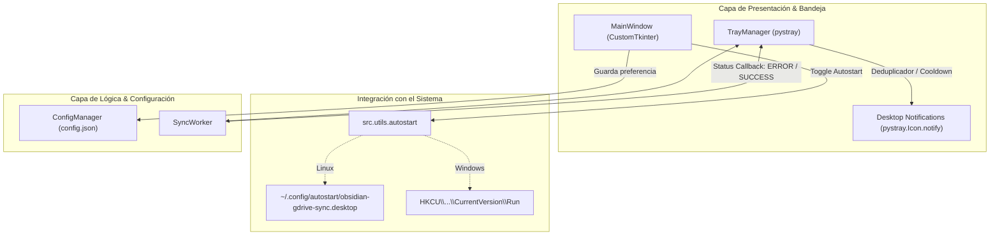
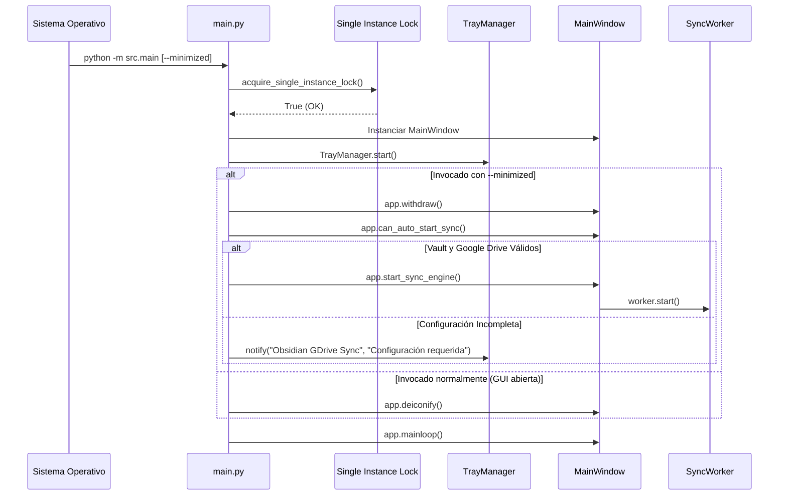

# Especificación Técnica: Integración con el Sistema (Autostart y Notificaciones de Escritorio)

**Fecha:** 2026-09-26  
**Estado:** Propuesta Aprobada  
**Plataformas:** Windows (10/11) y Linux (GNOME, KDE, XFCE, etc.)  

---

## 1. Resumen Ejecutivo

Esta especificación detalla el diseño técnico para dotar a **Obsidian GDrive Sync** de capacidades de integración nativa con el sistema operativo:
1. **Inicio Automático con el Sistema (Autostart):** Capacidad de arrancar de forma silenciosa e inadvertida al iniciar sesión el usuario en Windows y Linux, activando el motor de sincronización en segundo plano (`--minimized`) en la bandeja del sistema si el vault y la cuenta están configurados.
2. **Notificaciones Nativas de Escritorio (Desktop Notifications):** Alertas nativas a través del sistema de bandejas (`pystray.Icon.notify`) ante errores críticos (caída de red, expiración de tokens, activación de guardas de seguridad contra borrados masivos o detección de conflictos), aplicando una estricta política de **deduplicación y cooldown (anti-spam)** para no saturar al usuario cada 2 minutos.
3. **Cero Dependencias Adicionales:** Implementación apoyada exclusivamente en la biblioteca estándar de Python (`winreg`, `os`, `pathlib`) y en las capacidades nativas ya presentes en `pystray`.

---

## 2. Objetivos y No-Objetivos

### Objetivos
- Permitir al usuario activar/desactivar el inicio con el sistema operativo desde un checkbox en la interfaz gráfica.
- Soportar estándares nativos del SO: especificación XDG Autostart (`~/.config/autostart/*.desktop`) en Linux y el Registro de Usuario (`HKCU\Software\Microsoft\Windows\CurrentVersion\Run`) en Windows.
- Al arrancar con `--minimized`:
  - Ocultar la ventana de la aplicación de inmediato (`app.withdraw()`).
  - Mostrar el icono en el System Tray.
  - Iniciar automáticamente el bucle de sincronización si el vault local y Google Drive están debidamente configurados.
  - Permanecer en espera en la bandeja si la configuración está incompleta, emitiendo una notificación informativa de configuración requerida.
- Notificar al usuario mediante el sistema de notificaciones del escritorio cuando ocurran fallos de sincronización o guardas de seguridad.
- Suprimir notificaciones repetitivas del mismo error recurrente en intervalos de hasta 15 minutos, limpiando el bloqueo tras una sincronización exitosa.

### No-Objetivos
- No se implementarán servicios a nivel de sistema como demonios `root` o servicios `systemd` globales (la aplicación opera en el espacio de usuario gráfico).
- No se notificarán sincronizaciones rutinarias exitosas por defecto para evitar distracciones continuas cada 2 minutos.

---

## 3. Arquitectura y Componentes



### 3.1 Nuevo Módulo `src/utils/autostart.py`

Provee una interfaz limpia y desacoplada del framework de GUI:

* **`is_autostart_supported() -> bool`**: Retorna `True` en `sys.platform.startswith(("linux", "win"))`.
* **`get_autostart_command() -> str | list[str]`**:
  - Si se ejecuta mediante el intérprete Python (`sys.executable`):
    - En Linux: `f'"{sys.executable}" -m src.main --minimized'`
    - En Windows: Busca `pythonw.exe` en el mismo directorio de `sys.executable` para evitar la ventana de consola; si existe, usa `pythonw.exe`, de lo contrario `sys.executable`.
  - En Linux, el comando y la ruta de trabajo (`Path`) apuntan al directorio raíz del proyecto (`get_project_root()`).
* **`set_autostart(enabled: bool) -> bool`**:
  - **Linux:**
    - Directorio: `Path.home() / ".config" / "autostart"` (creado con permisos `0o700` si no existe).
    - Archivo: `obsidian-gdrive-sync.desktop`.
    - Si `enabled=True`: Escribe el archivo `.desktop` con contenido:
      ```ini
      [Desktop Entry]
      Type=Application
      Name=Obsidian GDrive Sync
      Comment=Sincronización continua de Obsidian Vault con Google Drive
      Exec=<comando_autostart>
      Path=<directorio_proyecto>
      Terminal=false
      Categories=Utility;Sync;
      X-GNOME-Autostart-enabled=true
      ```
    - Si `enabled=False`: Elimina el archivo `.desktop` mediante `unlink(missing_ok=True)`.
  - **Windows:**
    - Utiliza `winreg.OpenKey(winreg.HKEY_CURRENT_USER, r"Software\Microsoft\Windows\CurrentVersion\Run", 0, winreg.KEY_SET_VALUE)`
    - Si `enabled=True`: `winreg.SetValueEx(key, "ObsidianGDriveSync", 0, winreg.REG_SZ, cmd_str)`
    - Si `enabled=False`: `winreg.DeleteValue(key, "ObsidianGDriveSync")` (manejando `FileNotFoundError` limpiamente).
* **`is_autostart_enabled() -> bool`**:
  - **Linux:** Comprueba si el archivo `.desktop` existe.
  - **Windows:** Consulta el registro mediante `winreg.QueryValueEx`.

### 3.2 Notificaciones y Deduplicación en `src/tray/tray_icon.py`

Se amplía `TrayManager` para gestionar notificaciones nativas seguras:

* **Variables de Estado en `TrayManager`**:
  - `_last_notified_error: str = ""`
  - `_last_notified_timestamp: float = 0.0`
  - `COOLDOWN_SECONDS: int = 900` (15 minutos)
* **Método `notify(title: str, message: str)`**:
  - Verifica si `self.icon` está inicializado y cuenta con el método `notify`.
  - Invoca `self.icon.notify(message, title)` encapsulado en un bloque `try/except Exception` para registrar en el log cualquier anomalía del servidor gráfico sin interrumpir la ejecución.
* **Integración en `update_status(status: SyncStatus, msg: str)`**:
  - Si `status == SyncStatus.ERROR`:
    - Evalúa si el mensaje es igual a `_last_notified_error` y si el tiempo transcurrido es menor a `COOLDOWN_SECONDS`.
    - Si califica para notificación, dispara `self.notify("Obsidian GDrive Sync - Error", msg)` y actualiza el timestamp y último error.
  - Si `status in (SyncStatus.SUCCESS, SyncStatus.IDLE)`:
    - Restablece `_last_notified_error = ""` y `_last_notified_timestamp = 0.0`, permitiendo que futuros fallos nuevos se notifiquen de inmediato.

### 3.3 Modelo de Configuración `src/core/config.py`

* Se agrega a `ConfigData`:
  ```python
  autostart_enabled: bool = False
  ```
* Se mantiene retrocompatibilidad total con archivos `config.json` existentes.

### 3.4 Interfaz de Usuario `src/gui/app_window.py`

* Se añade un `CTkCheckBox` en el formulario:
  - Texto: *"Iniciar automáticamente con el sistema"*.
  - Estado inicial vinculado a `is_autostart_enabled()`.
  - Callback `_on_toggle_autostart`: Invoca `autostart.set_autostart(checked)` y persiste el valor en `config.json`.
* Se extrae el método `start_sync_engine() -> bool`:
  - Contiene la validación unificada de ruta de vault local (no vacía, existe, no es raíz `/` ni `$HOME`) y autenticación de Google Drive.
  - Es utilizado tanto por el botón de la interfaz como por el arranque automático de `main.py`.

### 3.5 Ciclo de Vida y Arranque en `src/main.py`



---

## 4. Manejo de Errores y Seguridad

1. **Permisos y Ubicaciones Seguras:**
   - La carpeta `~/.config/autostart` se crea con permisos `0o700`.
   - En Windows, solo se escribe en `HKCU` (HKEY_CURRENT_USER), sin requerir privilegios de Administrador ni tocar `HKLM`.
2. **Resiliencia ante Fallos de Notificación:**
   - Si el entorno Linux carece de demonio de notificaciones (por ejemplo en ciertas configuraciones mínimas de Wayland o i3/sway sin `mako`/`dunst`), `pystray.Icon.notify` no abortará la aplicación.
3. **Validación de Comando de Autostart:**
   - Si la ruta del proyecto o del entorno virtual contiene espacios, se entrecomillan adecuadamente los argumentos en el archivo `.desktop` y en el Registro.

---

## 5. Estrategia de Pruebas Automatizadas (Pytest)

Se implementarán las siguientes suites de pruebas:

1. **`tests/test_autostart.py`**:
   - `test_linux_autostart_lifecycle(tmp_path, monkeypatch)`: Comprueba la creación de `obsidian-gdrive-sync.desktop` en `tmp_path`, verifica su contenido (`[Desktop Entry]`, `Exec`, `Path`), valida `is_autostart_enabled() == True`, y comprueba su borrado con `set_autostart(False)`.
   - `test_windows_autostart_lifecycle(monkeypatch)`: Simula `winreg` mediante `unittest.mock` para verificar `SetValueEx`, `QueryValueEx` y `DeleteValue`.
   - `test_autostart_idempotency()`: Llamar a `set_autostart(True)` o `set_autostart(False)` múltiples veces consecutivas no lanza excepciones.
2. **`tests/test_tray_notifications.py`**:
   - `test_notify_triggered_on_error()`: Ante `SyncStatus.ERROR`, invoca `icon.notify`.
   - `test_notify_deduplication()`: Errores idénticos consecutivos no disparan `icon.notify` más de una vez dentro de la ventana de cooldown.
   - `test_notify_reset_on_success()`: Un evento `SyncStatus.SUCCESS` restablece el estado para que un error posterior vuelva a notificar.
   - `test_notify_exception_tolerance()`: Si `icon.notify` lanza una excepción, `update_status` captura el error y no interrumpe el flujo.
3. **`tests/test_main_startup.py`**:
   - Validación del auto-arranque del motor con `--minimized` cuando la configuración es válida vs cuando el vault es inexistente.

---

## 6. Plan de Implementación (Handoff a writing-plans)

1. Crear módulo `src/utils/autostart.py` y suite `tests/test_autostart.py` (TDD).
2. Extender `ConfigData` con `autostart_enabled` en `src/core/config.py`.
3. Implementar notificaciones y deduplicación en `src/tray/tray_icon.py` y `tests/test_tray_notifications.py`.
4. Añadir checkbox y lógica de auto-arranque en `src/gui/app_window.py` y `src/main.py`.
5. Ejecutar la suite completa de pruebas unitarias (`pytest`).
